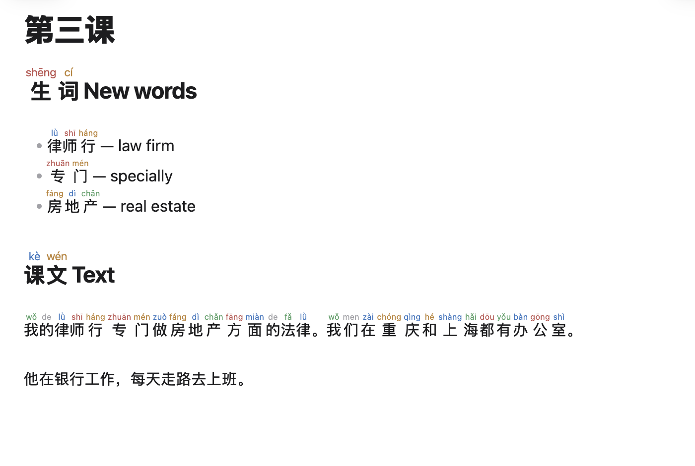

# Tahoe Pinyin

**Pinyin above the Chinese in your notes, with no markup.** Write Chinese as you normally would, and Tahoe Pinyin shows the pinyin over each character, in Reading view and in Live Preview. Your notes don't change: the pinyin is drawn on screen, not written into the file.



- **The right reading for each word.** Characters with more than one reading get the one their word needs: 银行 yín háng but 行走 xíng zǒu, 重庆 chóng qìng but 重要 zhòng yào.
- **Live Preview too.** The line you're typing on stays plain text, so your Chinese input method works as usual. The pinyin comes back when you move to another line.
- **Tones your way:** marks (zhōng), numbers (zhong1) or none (zhong), and optional tone colors: first tone red, second orange, third green, fourth blue, neutral gray. Pick your own colors if you like.
- **Practice mode:** the pinyin stays hidden until you point at a character, or tap it on iPhone and iPad.
- **Characters you know:** select characters and run **I know the selected characters** (or right-click), and their pinyin stops showing, so it appears only where you still need it. Edit the list in the settings.
- **Fix a reading:** select a word, right-click and choose **Fix pinyin…** (or run **Fix pinyin for the selected word**). The correction applies wherever that word appears. Every correction is listed in the settings, where you can edit them, with tone marks or numbers (`lv4 shi1 hang2`).
- **Per note:** add `pinyin: false` to a note's properties to turn it off there, or choose to show pinyin only in notes with `pinyin: true`.
- **Copying gives plain text.** Copy from Reading view and you get 银行, not 银yín行háng.
- **Hear it:** select Chinese and run **Read aloud** (or right-click → **Read aloud**) to hear it in your system's Chinese voice. With nothing selected, it reads the line you're on. Pick the voice and speed in the settings.

Code, code blocks and math are left alone, and so is Japanese (text with kana), so kanji don't get pinyin.

## Using it

1. Install it from Settings → Community plugins → Browse → "Tahoe Pinyin" (once it's listed there), or copy `main.js`, `manifest.json` and `styles.css` from the [latest release](https://github.com/krishnanefx/obsidian-tahoe-pinyin/releases/latest) into your vault's `.obsidian/plugins/tahoe-pinyin/` folder.
2. Turn it on, and open a note with Chinese in it.
3. Settings → Tahoe Pinyin has the tone style, tone colors, practice mode, size and your corrections. The commands **Show or hide pinyin** and **Show or hide pinyin in this note** turn it off and on.

It uses no desktop-only features, so it's made to work on iPhone and iPad as well as on the desktop.

## Coming from another pinyin plugin

- **[Zhongwen Block](https://github.com/0918nobita/obsidian-zhongwen-block):** adds pinyin to text inside ` ```zh-cn ` code blocks, shown when you hover, and Jyutping for Cantonese in ` ```zh-hk ` blocks. Tahoe Pinyin needs no code blocks: it works on the Chinese anywhere in your notes, while you edit too. It doesn't do Jyutping.
- **[Big Characters](https://github.com/a-zasypalov/Obsidian-Big-Characters):** adds pinyin to text you wrap in its `<span>` markers or code blocks, and also does Japanese and Korean. Tahoe Pinyin needs no markers, and is for Chinese only.

## Feedback

Questions are welcome in [Discussions](https://github.com/krishnanefx/obsidian-tahoe-pinyin/discussions), and bugs and ideas in [Issues](https://github.com/krishnanefx/obsidian-tahoe-pinyin/issues/new/choose). A wrong reading is worth reporting: say the word, what it showed and what it should be. If Tahoe Pinyin is useful to you, a star helps others find it.

<!-- tahoe-family -->
## The Tahoe family

Tahoe is a set of plugins and a theme that work on their own and fit together.

| | | |
| --- | --- | --- |
| **[Tahoe Run](https://github.com/krishnanefx/obsidian-tahoe-run)** | Run the code in your notes, like a notebook: Python with a debugger and variables view, MATLAB, and ~25 other languages. | available |
| **[Tahoe Math](https://github.com/krishnanefx/obsidian-tahoe-math)** | A calculator in your notes: type an expression ending in `=` and the answer appears. | available |
| **[Tahoe](https://github.com/krishnanefx/obsidian-tahoe-theme)** | A clean, Mac-like theme, in light and dark. | available |
| **[Tahoe Code](https://github.com/krishnanefx/obsidian-tahoe-code)** | An IDE in your code blocks: suggestions, checking as you type, quick fixes, go to definition, formatting and AI edits. | available |
| **[Tahoe Glass](https://github.com/krishnanefx/obsidian-tahoe-glass)** | Real refraction for the Tahoe theme's glass, and header cards on settings pages. | available |
| **[Tahoe Organize](https://github.com/krishnanefx/obsidian-tahoe-organize)** | Keep a growing vault tidy: inbox triage, smart folders, colored tags, link suggestions, vault health, literature notes and text from images. | available |
| **[Tahoe Intelligence](https://github.com/krishnanefx/obsidian-tahoe-intelligence)** | On-device AI for your notes: ask your notes, related notes, distilling permanent notes and more. | available |
| **[Tahoe OCR](https://github.com/krishnanefx/obsidian-tahoe-ocr)** | Search the text in your images: screenshots, slides and scanned pages, read on your Mac. | available |
| **Tahoe Pinyin** | Pinyin above the Chinese in your notes, with the right reading for each word, tone colors and a practice mode. | this one |

**Better together**

- **With [Tahoe](https://github.com/krishnanefx/obsidian-tahoe-theme):** the pinyin sits in the theme's muted text colour, and tone colours are tints of its own colours, in light and dark.
<!-- /tahoe-family -->

## Disclosures

- **Network use:** none from the plugin. The dictionary is part of it. Read aloud hands the text to your system's speech engine; on Mac, iPhone and iPad its voices run on the device.
- **Files in your vault:** your settings and corrections are saved in the plugin's folder (`data.json`). **Show or hide pinyin in this note** writes a `pinyin` property to that note; nothing else is written to your notes.
- **Clipboard:** when you copy text that has pinyin showing, it puts that text on the clipboard without the pinyin, as you'd expect from copying.
- **No telemetry, ads, accounts or payments.**

## License

[MIT](LICENSE) © 2026 Krishnan Adaikkappan. It includes [pinyin-pro](https://github.com/zh-lx/pinyin-pro) (MIT): see [THIRD_PARTY_NOTICES.md](THIRD_PARTY_NOTICES.md).

## Building from source

```sh
npm ci
npm run build     # writes main.js
```

Releases are built by GitHub Actions: push a tag that matches the version in `manifest.json`, then publish the draft release it creates.
